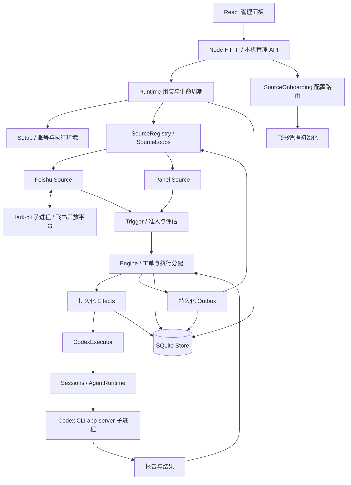

# 007 Architecture

本文描述当前实现。项目是一个独立的 Node.js + TypeScript 应用：React 管理面板、SQLite 持久化、Codex CLI 执行器，以及可注册的消息来源。飞书已经拆成仓库内的前后端集成模块；仍由同一个进程部署，尚未发布为独立 npm 包。

## 整体结构



生产环境由 Node 同时提供管理 API 与构建后的 Web 静态资源，默认仅监听 `127.0.0.1:4317`。开发环境通过 Vite 中间件提供热更新。飞书 CLI 和 Codex CLI 都是独立子进程，不在 HTTP 请求内执行长期任务。

## 目录与职责

```text
src/
  index.ts                         HTTP、配置文件、启停及 Runtime 重载
  deployment.ts                    部署类型、机器配置、旧账号导出兼容
  policy.ts / admission.ts         授权、准入与策略版本
  core/                            领域模型与 Engine
  app/                             应用编排、持久化、会话、工具和 API
    source-plugins.ts              后端外部来源注册入口
    setup.ts                      按来源解析账号与生成命令包装脚本
    runtime.ts                    组装依赖、运行和关闭
  sources/                         通用来源接口、注册表与生命周期
    kind.ts / server.ts            来源描述与服务端扩展契约
    host.ts                       来源可以调用的宿主能力
    registry.ts                   配置、策略、通道、资源及链接分派
    loops.ts                      消费循环启动、取消、替换和等待退出
    onboarding.ts                 本机配置 API 分派
    panel.ts                      本地操作者输入与回复
    poll.ts                       通用线程轮询辅助
    feishu*.ts                    旧导入路径兼容转发
  integrations/feishu/
    shared/                       前后端共享类型、账号类型和错误文案
    client/                       连接表单、成员选择适配、API 与文案
    server/                       飞书后端实现
  contracts/                      无运行时依赖的前后端设置 DTO
  client/                         React 页面与通用设置框架
    plugins.ts                    前端来源组件注册入口
    plugin-locales.ts             来源文案组合入口
    source-plugins.tsx            组件扩展接口与注册上下文
  executor/                       Codex 执行适配与 app-server 协议
  infra/                          子进程、文件路径、健康状态、KV 键等
  kv.ts                           应用 KV 目录与旧键兼容导出
prompts/                          主智能体、Worker、交接及团队提示词
skills/                           内置飞书技能说明
tests/                            领域、协议、来源、UI、生命周期测试
scripts/                          真实 Codex 本机验证脚本
examples/                         部署配置与服务管理示例
docs/                             领域、授权、执行、部署等设计文档
```

## 领域层：core

`Engine` 负责 Trigger、Thread、Decision、Ticket 和 Assignment 的领域状态变化：

| 对象 | 含义 |
| --- | --- |
| Trigger | 已接收的单条不可变输入，携带来源、发送者、时间和原生消息标识 |
| Thread | 会话及其订阅关系，归集消息和待评估内容 |
| Decision / Eval | 对输入是否构成任务的评估与决策记录 |
| Ticket | 一项工作的授权依据、输入、报告、状态和交付目标 |
| Assignment | 某个工单的一次执行分配及进度 |
| Mandate / Policy | 任务授权依据与当前策略，决定什么工作仍然被允许 |

核心通过 `core/ports.ts` 中的 Policy、Assessor、Executor、Outbox、Repositories 等接口调用外部能力，不导入 HTTP、CLI 或数据库实现。任务状态与模型会话状态分开：Codex 一轮结束不等于任务成功，Worker 的 ready 报告也不等于外部消息已经送达。

核心仍保留现有飞书图片引用的兼容语义，见本文最后的边界说明。

## 应用层：app

| 模块 | 责任 |
| --- | --- |
| Runtime | 获取状态目录锁，创建 Store、Setup、注册表、Engine、会话和执行器；协调初始化、重载、关闭 |
| Setup | 校验支持的 Codex CLI，逐个执行来源账号解析，收集账号故障，生成执行环境命令包装脚本 |
| Settings | 校验配置、版本冲突检测、策略保存、账号修改权限、群成员同步和目录绑定授权 |
| Passes / MasterAssessor | 调度准入后评估，将候选交给主智能体，接收评估结果 |
| Effects | 保存和执行事务提交后的副作用，管理并发与重试 |
| Sessions / Prompts | 组合角色指令、内置技能、团队覆盖和应用工具，维护应用会话与提示词版本 |
| Outbox | 在 SQLite 中登记消息回执，通过来源通道发送并重试，保留不确定状态供检查 |
| Resources / Links | 在授权检查后分派来源资源读取；按会话缓存分页；解析和缓存原消息链接 |
| HTTP / Views | 接收管理命令，生成面板视图；向浏览器提供公开账号信息，不回传 Secret |

SQLite 事务负责一致的状态提交。耗时 CLI 调用和外部消息发送由 Effects、来源循环或会话执行器完成，不长期占用领域事务。

## 来源框架：sources

一个 `SourceKind` 可声明：

| 扩展点 | 作用 |
| --- | --- |
| `schema`、`fields`、`connection` | 配置校验、Web 普通字段、公开连接状态 |
| `setup.fields`、`setup.resolve` | 标记改变账号后需要重载的字段，验证并解析来源账号 |
| `setup.shims` | 提供该来源的 Worker 命令包装脚本 |
| `setup.onboarding` | 声明凭据配置路径与处理器工厂 |
| `run` | 长期事件消费、补收或轮询任务，接受取消信号 |
| `scope`、`policy` | 接收范围、允许用户、准入表、成员读取与名单同步 |
| `channel` | 发送回复、判断目标是否仍允许交付、构造会话链接 |
| `threadContext` | 评估需要的线程、原消息、父消息及图片上下文 |
| `resources`、`messageLink` | 智能体原文资源、分页读取、原消息链接及失败回退 |
| `workspaces`、`workspaceKey` | 会话绑定工作目录和固定 Worker |
| `skills`、`environment` | 向执行环境提供来源技能名和环境变量 |

后端组合入口是 `app/source-plugins.ts`；本地面板来源由 Runtime 单独注册，因此移除外部来源后仍可接收本地请求。当前服务端仍是一种来源对应一个实例；前端虽然区分 kind 和 instance ID，本次改造没有引入多机器人或多租户。

`SourceContext` 只暴露输入接收、受限状态读写、线程描述、工单关联、通知和健康报告等能力。来源负责适配外部消息，任务状态仍交给 Engine。

`SourceLoops` 保证重复 start 不会重复创建消费者；注销来源时取消其循环；重新注册同一来源时等待旧循环退出后再启动；停机时等待所有消费者及其收尾工作完成，随后才能关闭数据库。单个循环失败会记录对应来源的健康状态，不终止其他来源。

`SourceOnboarding` 的处理器与 HTTP 服务同生命周期，跨 Runtime 重载保留串行化状态，避免两次机器人配置互相覆盖。配置请求继续经过入口的同源检查。

## 飞书模块

| 文件 | 职责 |
| --- | --- |
| `server/source.ts` | 注册所有飞书扩展，定义配置、监听范围、用户名单、群成员同步与工作目录绑定 |
| `server/account.ts` | 验证 CLI、应用和机器人身份，强制 strict mode bot，生成 lark-cli 包装脚本内容 |
| `server/setup.ts` | 检测 App ID/Secret，建立独立 CLI 配置，保存并启用来源 |
| `server/commands.ts` | 机器人身份的 CLI 参数、JSON 响应解析与飞书错误转换 |
| `server/loops.ts` | 实时事件、群历史补收、订阅线程轮询、群名称刷新 |
| `server/trigger.ts` | 事件规范化与稳定 Trigger/Thread/Channel 标识 |
| `server/read.ts` | 原文、根消息、父消息、线程、相邻历史及分页链接读取 |
| `server/channel.ts` | 线程回复、群发送、图文 post、消息幂等键与会话链接 |
| `server/image.ts`、`server/upload.ts` | 入站图片读取与模型附件、受工作目录约束的出站图片上传 |
| `server/state.ts` | 飞书历史游标、已见消息和初始化标记的持久键定义 |
| `client/plugin.tsx` | 飞书 Web 扩展注册对象 |
| `client/connection-form.tsx` | 机器人凭据输入、检测、保存和宿主重载回调 |
| `client/people-picker.tsx` | 飞书成员查询、open_id 规则、权限错误说明 |
| `shared/` | 公开账号类型、请求响应契约与稳定错误文案 |

实时事件通过 `lark-cli event consume im.message.receive_v1 --as bot` 建立长连接。事件消费者断线后退避重连；停用来源时终止消费。历史补收保存每个群的游标，并通过重叠时间窗口与稳定 Trigger ID 去重；已有订阅线程继续按范围轮询。群列表单独刷新，不被较慢的历史补收阻塞。

来源未配置或账号不可用时，飞书健康状态显示等待或故障；只要全局 Codex 初始化成功，本地面板与其他来源可以继续运行。

## Web 层

普通配置链路是 `SourceKind.fields → settingsView → SourceCard / SourceField → useBlockDraft`。字段描述、公开连接状态和策略展示信息由 `contracts/source-settings.ts` 定义，不依赖 Node 运行时代码。

特殊流程通过 `client/source-plugins.tsx` 注册。主页面根据 kind 选择组件，按实例 ID 请求数据和保存。连接表单通过 props 接收翻译、配置函数、公开账号状态及刷新/重载回调，不读取全局 Panel 状态。

`AllowedPeople` 只处理范围、搜索、勾选和手工添加；飞书模块注入群成员读取、open_id 规则与错误提示。组件仅调用父页面的 `onChange` 更新策略草稿，整个 policy 块仍由主应用带 revision 统一保存。

普通设置继续有浏览器草稿、并发冲突处理和配置历史。凭据使用专用表单，不进入通用草稿、浏览器存储或配置历史；成功保存后清空 Secret。

移除前端扩展后，特殊连接入口消失，已有普通配置仍可由字段元数据渲染。移除后端来源后，已保存的来源记录保留并显示未安装，避免丢失配置。

## 执行器与会话

`AgentRuntime` 是提供方无关的会话接口，`CodexRuntime` 通过受版本约束的 Codex CLI app-server 协议实现。`CodexExecutor` 将工单分配转为 Worker 会话执行；`Sessions` 注册工具、组合指令、注入后续输入和记录会话。

默认每个 Ticket 有独立工作目录与持久 Codex 会话。设置群项目目录后，该群任务共用固定 Worker 和项目上下文，串行执行；每个工单仍分别保留授权、报告和回复记录。绑定快照写入任务，后续绑定修改只影响新任务。

工具执行按角色、工单生命周期和授权关系检查。原文资源在调用来源读取器前检查 Trigger 是否属于当前 Worker 可访问的工单。文件下载、上传限制在允许目录。执行和应用访问审批交给本机面板，重启会使未完成审批失效。

## 端到端数据流

1. 飞书事件、补收消息或面板输入规范化为 Trigger。
2. 来源接收范围和 Policy 判断准入，记录被忽略或可评估的输入。
3. 主智能体结合已有工单、上下文和规则，决定忽略、创建、附加或停止工作。
4. Engine 在事务内更新工单与分配，并登记待执行副作用。
5. CodexExecutor 创建或恢复 Worker，Sessions 提供指令、工具和后续输入。
6. Worker 通过应用工具汇报进展、问题或结果；主智能体安排交付。
7. Outbox 保存回复回执，通过 SourceRegistry 分派到飞书或面板通道。
8. 飞书通道使用稳定幂等键发送原线程回复；本地结果和外部交付状态分别记录。

## 配置与持久化

| 数据 | 所在位置与所有者 |
| --- | --- |
| 机器配置 | `superagent.config.json`：stateDir、port、codexPath、提示词与读取限制 |
| 业务状态 | `<stateDir>/orchestrator.sqlite`：消息、线程、工单、决策、Effects、回复回执 |
| 设置与提示词 | 同一 SQLite 内的版本化快照与按块 revision |
| 会话与审批 | 持久化应用会话、提供方线程映射、交付记录和审批状态 |
| 机器人 CLI 配置 | `<stateDir>/feishu-bots/bot-*`；凭据由 lark-cli 的配置/凭据存储管理 |
| Worker 命令路由 | `<stateDir>/worker-bin` 下由来源提供的包装脚本与操作者禁用命令 |
| 工单目录 | 默认 `<stateDir>/work` 下的任务目录，或操作者授权的项目目录 |
| 飞书游标 | 保留 `feishu-chats`、`feishu-history:*`、`feishu-history-threads:*`、`thread-seen:*`、`thread-initialized:*` |

App Secret 通过 stdin 传入 CLI 初始化命令；身份预检使用私有临时配置并在结束后删除。业务设置仅保存 CLI 包装脚本路径。更换账号触发 Runtime 重载，正在运行的 Worker 会中断，需要按现有恢复流程检查。

## 兼容性和当前边界

本次拆分不需要数据库迁移，保留：

- `sources.feishu`、`policy.sources.feishu`、群绑定字段和来源 ID。
- `POST setup/feishu` 的请求响应、检测/保存语义以及 HTTP 同源要求。
- `<stateDir>/feishu-bots/bot-*`、现有 wrapper 路径和 strict bot 身份要求。
- Trigger/Thread ID、Outbox 幂等键、历史游标与旧消息资源路径。
- `src/sources/feishu*.ts`、`src/app/feishu-setup.ts` 的转发导出。
- `deployment.ts` 的旧账号验证导出与 `Deployment.feishu`；新代码同时使用通用 accounts 映射。
- `Commands.lark()` 兼容方法，实际 CLI 处理委托给飞书模块。
- HTTP 的旧 `accounts.feishu`、`feishuProblem` 字段；Web 使用公开连接视图。

目前是静态注册、同进程的模块化架构。仍有明确保留的飞书语义：`core/message-images.ts` 与 `core/replies.ts` 的 image_key 校验、应用 Outbox 的图片目标限制、`orchestrator_image_upload` 工具入口，以及内置飞书技能和部分既有文案。它们保障已有工具协议与图片交付行为，因此不能把当前核心称为完全平台无关的多媒体框架。后续若要扩展不同平台的附件格式，需要单独设计通用附件契约和工具兼容方案。

## 验证方式

`npm run check` 执行类型检查、Vitest 和前后端生产构建。测试使用确定性的 Codex app-server 与飞书 CLI fixture，覆盖现有读取、收发、身份隔离、配置历史和图片行为，并新增：来源启停与替换等待、故障隔离、移除飞书后的面板运行、旧导入与游标兼容、通用账号/命令扩展、原文资源授权。

自动测试不向真实飞书群发消息。真实账号与权限联调仍按 [SETUP.md](../SETUP.md) 在专用测试群执行。
